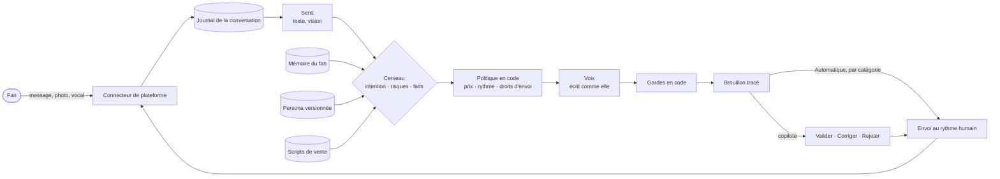
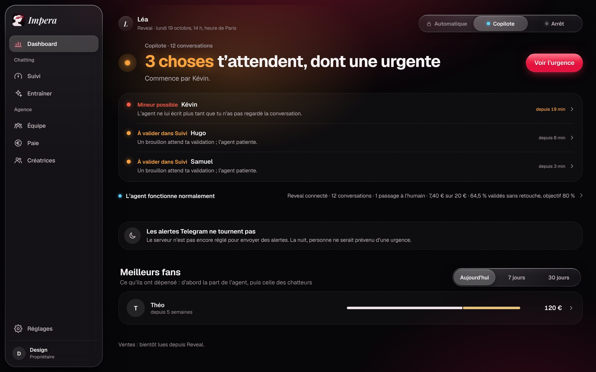
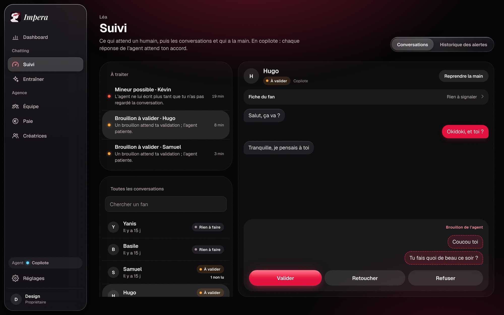
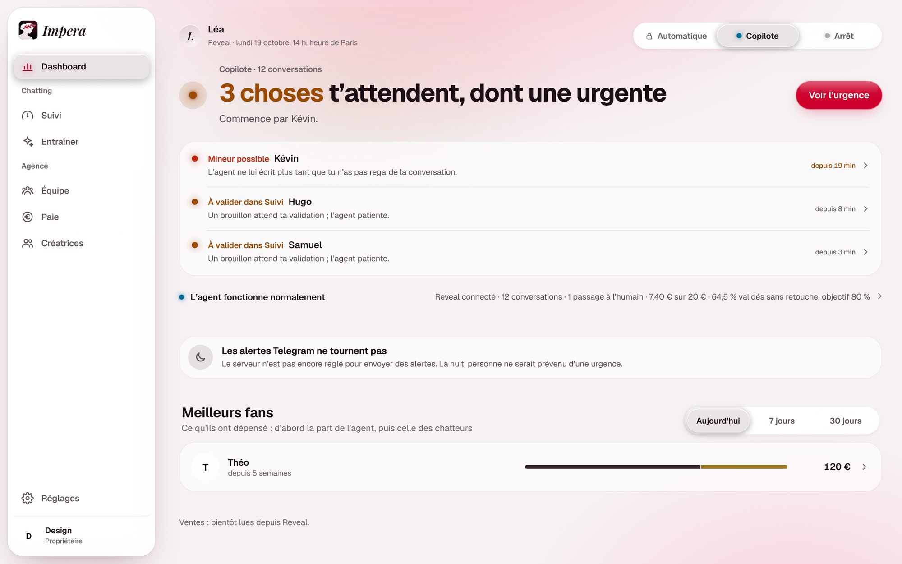
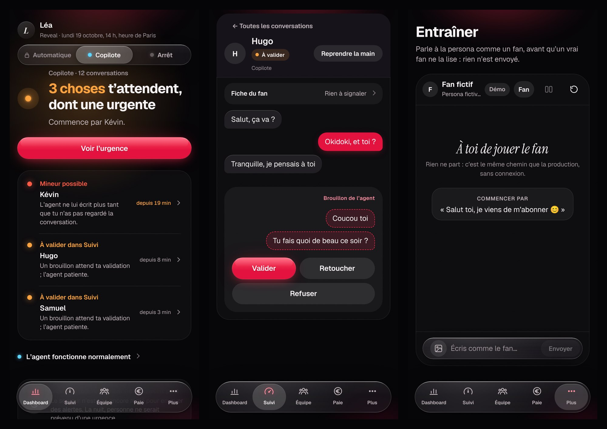
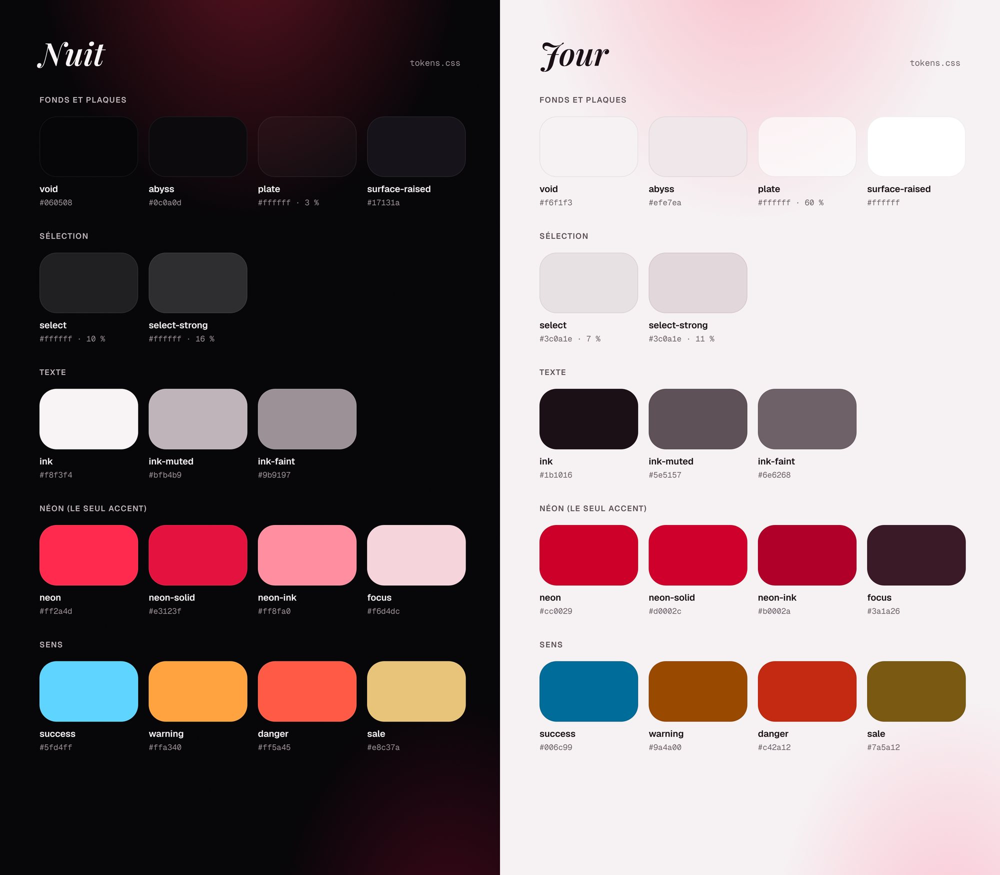

<p align="center">
  
</p>

<p align="center">
  
  
  
  
  
  
  <a href="LICENSE"></a>
</p>

<p align="center">
  <b>Impera Studio</b> est le logiciel d'exploitation d'une agence de créatrices de contenu.<br>
  Un agent de chatting IA qui parle avec la voix de la créatrice, et autour de lui tout ce que l'agence fait tourner :<br>
  supervision des conversations, équipe de chatteurs, planning, paie, factures, scripts, espace de la créatrice.
</p>

<p align="center">
  <a href="#ce-que-fait-impera">Ce qu'il fait</a> ·
  <a href="#où-on-en-est">État</a> ·
  <a href="#comment-lagent-répond">L'agent</a> ·
  <a href="#architecture">Architecture</a> ·
  <a href="#installer-et-lancer">Installer</a> ·
  <a href="#notices-dutilisation">Notices</a> ·
  <a href="#commandes">Commandes</a> ·
  <a href="#contribuer">Contribuer</a> ·
  <a href="#licence">Licence</a>
</p>

---

> **Session de code ?** Commence par [`CLAUDE.md`](CLAUDE.md), puis [`docs/00-START-HERE.md`](docs/00-START-HERE.md). Tout le reste en découle.

## Ce que fait Impera

Une créatrice sur une plateforme d'abonnement reçoit chaque jour des dizaines de conversations privées. Chaque fan attend une réponse personnelle, rapide, qui se souvient de lui : c'est ce qui fidélise et ce qui fait acheter les médias privés. Une agence tient ce rythme avec une équipe de chatteurs, des plannings, des scripts de vente, une paie à la commission. Impera met tout ça dans un seul outil, avec un agent IA au centre.

**Un agent de chatting qui incarne la créatrice.** Il lit la conversation, se souvient de ce que le fan a raconté, choisit quoi faire (faire connaissance, proposer un script, laisser respirer) et écrit dans la voix de la créatrice. Les décisions qui comptent (vendre ou non, quoi, à quel prix, à quel rythme) sont prises par du code testé, pas par le modèle : le modèle n'écrit que le texte. Il ne sort jamais du personnage, ne promet ni amour ni rencontre, et coupe toute pression commerciale devant un fan en détresse ou peut-être mineur.

**Copilote d'abord, autonome ensuite.** Chaque réponse est un brouillon qu'une personne valide, corrige ou rejette. L'agent gagne le mode Automatique catégorie par catégorie, quand ses brouillons passent sans retouche, et un arrêt d'urgence coupe tout en une commande.

**Tout ce qui entoure le chatting** :

| Pour qui | Ce qu'Impera lui donne |
|---|---|
| **L'agence** (propriétaire, managers) | Dashboard en direct (santé de l'agent, ventes, fans à traiter), Suivi des conversations et de leurs alertes, Entraîner (playground, corrections, tests à l'aveugle), Créatrices (persona, pourcentage de l'agence, heures de l'agent), Réglages (modèles IA, flux de ventes, alertes, Telegram, règles de paie, facturation, sauvegardes, sécurité) |
| **Les chatteurs** | Aujourd'hui, leurs conversations pendant leur shift et rien en dehors, leur planning avec congés et échanges de shifts, leurs ventes saisies une à une, leurs commissions et leurs factures |
| **L'équipe** | Planning partagé où l'agence pose et déplace les shifts au doigt, rapports de fin de shift contrôlés par le code, paie par quinzaine au centime, factures PDF/A et avoirs, exports pour le comptable |
| **La créatrice** | Une appli sur son téléphone (PWA) : sa journée et qui répond à ses fans, sa persona ; ses fans et leurs conversations en lecture seule arrivent avec Ventes. Elle ne voit ni l'IA, ni qui a écrit un message, ni la paie de l'équipe, ni les notes de l'agence sur ses fans ([ADR 0042](docs/adr/0042-creator-space.md), [ADR 0063](docs/adr/0063-no-fan-notes-for-the-creator.md)) |

Le cœur ne connaît aucune plateforme. Reveal.me est la première, branchée par un adaptateur ; d'autres suivront, puis la plateforme propre d'Impera, sans rien changer au cœur.

## Où on en est

État de `main` au 3 novembre 2026. **Rien n'est en production**, et aucun message n'a encore été envoyé à un vrai fan.

| | Quoi |
|---|---|
| ✅ **Fait** | Socle : monorepo TypeScript strict, frontières de modules vérifiées par ESLint, Postgres avec isolation par créatrice (RLS), journal d'événements, worker, CI, gitleaks |
| ✅ **Fait** | Moteur de l'agent : passerelle multi-modèles avec coût de chaque appel et budget journalier, prompts versionnés, message du fan isolé comme donnée, gardes de sortie en code, mémoire du fan, vision des médias, playground et évaluations |
| ✅ **Fait** | Dashboard de l'agence : Dashboard, Suivi, Entraîner, Créatrices, Réglages ; connexion avec deuxième facteur ou clé d'accès (Face ID, empreinte), journal de sécurité |
| ✅ **Fait** | Équipe : membres et rôles, planning, congés et échanges, rapports de shift, paie, primes et malus, objectifs, factures et avoirs, exports comptables |
| ✅ **Fait** | Espaces mobiles : PWA de la créatrice et du chatteur, notifications Web Push, alertes de l'équipe sur Telegram |
| ✅ **Fait** | Exploitation : images Docker, compose de production, export quotidien chiffré de la base, runbooks |
| 🔶 **En cours** | Structures de script et cartons de tournage, veille de tendances Instagram, contrôle des ventes contre l'API de Reveal |
| ⏳ **En attente** | Capture de la session Reveal par l'extension (lecture et envoi réels), clés des fournisseurs IA, mise en service |

La feuille de route complète, phase par phase, avec ses critères d'acceptation : [`docs/roadmap.md`](docs/roadmap.md). Les décisions qui la structurent : [`docs/adr/`](docs/adr/README.md).

## Comment l'agent répond



- **Les règles métier vivent dans le code, pas dans les prompts.** Un prompt reçoit des décisions déjà prises et n'écrit que le texte ([ADR 0009](docs/adr/0009-llm-gateway-three-roles.md)).
- **Le message d'un fan est une donnée, jamais une instruction** : il entre dans le prompt dans un bloc délimité et typé, et les évaluations attaquent l'agent par injection, jeu de rôle et caractères invisibles.
- **Rester en personnage est fixé dans le code**, sans réglage ni sujet de prompt ([ADR 0021](docs/adr/0021-stay-in-character-fixed-in-code.md)).
- **Tout est tracé** : chaque brouillon garde son brief, les faits utilisés, le modèle et le coût, pour répondre à « pourquoi a-t-il dit ça ? ».
- **Un seul écrivain par conversation** : une file série par conversation, des clés d'idempotence à chaque envoi, des jobs rejouables ([ADR 0006](docs/adr/0006-graphile-worker-per-conversation-queues.md)).

| Rôle | Modèle | Repli |
|---|---|---|
| Voix et cerveau | Grok (xAI) | Mistral Large |
| Vision (photos, vidéos, vocaux) | Gemini Flash | Grok, bascule automatique |
| Vocaux dans la voix de la créatrice | ElevenLabs, en copilote seulement | vrais vocaux enregistrés |

Le moteur en détail : [`docs/architecture/ai-engine.md`](docs/architecture/ai-engine.md).

## Architecture

Un **monolithe modulaire** TypeScript. Chaque module a un domaine pur, des cas d'usage et une infrastructure, et n'expose que son `index.ts` ; ESLint refuse tout import qui traverse une frontière ([ADR 0002](docs/adr/0002-modular-monolith-boundaries.md)). Les plateformes sont des adaptateurs derrière un port ([ADR 0003](docs/adr/0003-platform-agnostic-core.md)).

```mermaid
flowchart TB
  subgraph Clients
    W[apps/web<br/>dashboard de l'agence · PWA créatrice et chatteur]
    X[apps/extension<br/>capture de session · veille (à venir)]
    T[Telegram<br/>alertes de l'équipe]
  end
  subgraph API["apps/api · Fastify + Graphile Worker"]
    direction LR
    subgraph Chatting
      CO[connectors] --> CV[conversations]
      CV --> AG[agent]
      AG --> FA[fans]
      AG --> PE[persona]
      AG --> ME[media]
      AG --> SC[scripts]
      CV --> SU[supervision]
      PL[playground]
    end
    subgraph Agence
      TE[team] --> SH[scheduling]
      TE --> PA[payroll]
      PA --> CT2[contractors]
      PA --> IN[invoicing]
      PA --> AC[accounting]
    end
    subgraph Socle
      PR[providers]
      NO[notifications]
      TG[telegram]
      AL[alerts]
      BK[backups]
    end
  end
  subgraph Packages
    CT[contracts · Zod]
    DB[db · Drizzle, RLS]
    LLM[llm · passerelle]
    DS[design-system]
  end
  W --> API
  X --> API
  TG --> T
  W --> DS
  X --> DS
  API --> CT
  API --> DB
  API --> LLM
  CO -.port PlatformConnector.-> R[(Reveal)]
  CO -.-> FR[(FakeReveal · tests)]
```

Les principes qui tiennent tout ([`docs/architecture/overview.md`](docs/architecture/overview.md)) :

1. **Journal d'événements** par conversation, en ajout seul, source de vérité ; les tables d'état sont des projections reconstructibles ([ADR 0007](docs/adr/0007-conversation-event-log.md)).
2. **Isolation par créatrice garantie par la base** (Row Level Security), pas par la discipline du code ([ADR 0005](docs/adr/0005-postgres-drizzle-rls.md)).
3. **Reveal à deux voies** : l'API CRM officielle pour les ventes et les chiffres, la session capturée par l'extension pour la conversation, avec rythme humain et coupe-circuit ([ADR 0050](docs/adr/0050-reveal-two-paths-crm-api-and-captured-session.md)).
4. **La persona est une donnée versionnée** (YAML validé par Zod), jamais du code ; la vraie vit hors du dépôt ([ADR 0010](docs/adr/0010-persona-as-versioned-data.md)).
5. **L'argent en centimes entiers**, les identifiants en UUID v7 typés ([ADR 0011](docs/adr/0011-money-and-ids.md)) ; la paie se recalcule à l'identique, version de moteur comprise.
6. **Les clés des services IA se collent dans le dashboard**, vérifiées puis chiffrées en base ; elles ne ressortent jamais, et l'extension n'en porte aucune ([ADR 0016](docs/adr/0016-provider-keys-entered-in-dashboard.md)).

| Couche | Choix |
|---|---|
| Langage | TypeScript strict, Node 22, pnpm 10 + Turborepo |
| API et jobs | Fastify 5, Zod 4, Graphile Worker (mêmes sources, deux points d'entrée) |
| Données | PostgreSQL 16, Drizzle, RLS par créatrice |
| Authentification | Better Auth, deuxième facteur, clés d'accès (WebAuthn) |
| IA | Vercel AI SDK derrière `LlmGateway` |
| Interface | Vite, React 19, TanStack Router et Query, Tailwind v4, PWA |
| Extension | WXT (Chrome, Manifest V3) |
| Qualité | Vitest, Testcontainers, évaluations maison avec juge LLM |
| Hébergement | Docker, Coolify, Neon, export chiffré hors Neon |

### Interface

**Liquid Glass sur une nuit chaude, un seul néon rouge** : le verre pour ce qui flotte (navigation, menus, feuilles), le contenu sur des plaques, le rouge pour l'action principale et les urgences, l'ambre pour les avertissements, et un test qui garantit le contraste AA dans les thèmes Nuit et Jour. Captures faites avec des données inventées.

<p align="center">
  
</p>

<table>
  <tr>
    <td width="50%"></td>
    <td width="50%"></td>
  </tr>
  <tr>
    <td width="50%"></td>
    <td width="50%"></td>
  </tr>
</table>

Guide du design system : [`docs/design/README.md`](docs/design/README.md). Code : [`packages/design-system`](packages/design-system). Logo et règles : [`brand/`](brand/README.md).

## Installer et lancer

Prérequis : **Node 22** (22.13 ou plus, pas 23 : `.nvmrc`), **pnpm 10** (`corepack enable`), **Docker**, et `gitleaks` et `ffmpeg` sur le PATH.

```bash
git clone https://github.com/leyzee/impera.git
cd impera
pnpm install                 # dépendances et hooks git (lefthook)
cp .env.example .env         # puis remplir les trois secrets, voir ci-dessous
docker compose up -d         # Postgres 16 de développement
pnpm db:migrate              # crée les tables ; finit par « Migrations applied. »
pnpm owner:create --email vous@example.com --name Vous
pnpm creator:create --name "Créatrice de test"
pnpm dev:crm                 # API sur :3000 (worker inclus), dashboard sur :5173
```

Ouvrir **http://localhost:5173** et se connecter avec le compte créé. `http://localhost:3000/ready` doit répondre `"status":"ready"`.

Les trois secrets de `.env` (`AUTH_SECRET`, `CREDENTIALS_ENCRYPTION_KEYS`, `SESSION_ENCRYPTION_KEYS`) se tirent au hasard ; la commande exacte, le sens de chaque variable et le tableau « Si ça coince » sont dans [`docs/runbooks/local-dev.md`](docs/runbooks/local-dev.md). Les clés des services IA peuvent rester vides : elles se collent plus tard dans le dashboard.

Rien ne part vers une plateforme ni vers un fan en local : chaque compte de plateforme a une garde d'écriture fermée par défaut (ADR 0018), et sans session capturée aucun message n'entre ni ne sort.

## Notices d'utilisation

### Premier lancement

1. **Créer le compte propriétaire** : `pnpm owner:create`. Il n'y a pas d'inscription publique ; le mot de passe est demandé deux fois, 12 caractères minimum, et vérifié contre les fuites connues.
2. **Activer le deuxième facteur** au premier passage : appli d'authentification et codes de secours, ou une clé d'accès (Face ID, empreinte), qui vaut alors mot de passe et code ([ADR 0046](docs/adr/0046-dashboard-access-second-factor.md), [ADR 0053](docs/adr/0053-passkey-sign-in.md)).
3. **Brancher les services IA** : Réglages › Modèles IA. On colle la clé de chaque fournisseur, Impera la vérifie, la chiffre et affiche l'état du service. Sans clé, l'agent ne génère rien et le dit sur le Dashboard.
4. **Ajouter une créatrice** : Créatrices › Ajouter une créatrice (ou `pnpm creator:create`). Puis sa persona, versionnée ; le pourcentage de l'agence, daté et jamais rétroactif ; les heures où l'agent chatte.
5. **Inviter l'équipe** : Équipe › Membres pour un chatteur ou un manager, Créatrices › Accès pour une créatrice. Impera donne un lien d'invitation valable 72 h, que tu transmets toi-même (aucun e-mail ne part) ; la personne y choisit son mot de passe, et son rôle décide de ce qu'elle voit.

### Au quotidien

- **Propriétaire et managers** : le **Dashboard** dit ce qui attend (fans à traiter, jobs bloqués, sauvegarde en retard, papiers manquants). **Suivi** liste les conversations de chaque créatrice suivie, avec la fiche du fan et l'historique des alertes. En copilote, les brouillons de l'agent s'y valident, se corrigent ou se rejettent. **Entraîner** sert à tester l'agent sans fan réel : playground, corrections, tests à l'aveugle qui ouvrent le mode Automatique ([ADR 0019](docs/adr/0019-two-rates-and-automatic-mode-gate.md)).
- **Équipe** : **Planning** pour poser et déplacer les shifts, **Rapports** pour les fins de shift, **Paie** pour clôturer la quinzaine, ajouter primes et malus, émettre les factures et sortir les exports du comptable.
- **Chatteurs** : **Aujourd'hui** pour la journée, **Suivi** pour la créatrice qu'ils ont en shift (rien hors shift, [ADR 0025](docs/adr/0025-chatter-access-during-shift.md)), **Planning** pour leurs shifts, congés et échanges, **Commissions** pour leurs ventes et leurs factures. Leur calendrier s'abonne depuis Moi › Calendrier.
- **Créatrice** : elle installe l'appli depuis le navigateur de son téléphone, guidée pas à pas par la page `/aide/installer`, puis règle ses notifications sur la page `/notifications` (depuis le menu de son compte). Elle y voit sa journée et sa persona ; ses fans, ses gains, son agenda et son contenu arrivent avec leurs écrans ([ADR 0042](docs/adr/0042-creator-space.md)).

### Extension Chrome

L'extension capturera la session du membre « bot » sur la plateforme et la déposera, chiffrée, côté serveur (en attente, voir [Où on en est](#où-on-en-est)) ; elle ne porte aucune clé et n'appelle aucun modèle. Pour la charger en développement : `pnpm --filter @impera/extension dev`, puis `chrome://extensions`, mode développeur, « Charger l'extension non empaquetée » sur `apps/extension/.output/chrome-mv3-dev`. Détails : [`apps/extension/README.md`](apps/extension/README.md).

### Alertes Telegram

Un bot de l'agence envoie les alertes de l'équipe (connexion en panne, ventes qui ne concordent pas, écarts graves de persona) dans des groupes choisis. Bot, groupes et routage se règlent dans Réglages › Telegram ; jamais de montant, de nom de fan ni de clé dans un message. Mise en place : [`docs/runbooks/telegram.md`](docs/runbooks/telegram.md).

### Arrêt d'urgence et exploitation

```bash
pnpm ops:kill-switch --on --scope global --reason "pause"   # plus aucune réponse ni envoi ; --off pour lever
pnpm ops:revoke-sessions --email membre@example.com          # déconnecte un compte (--all : tout le monde)
pnpm ops:reset-second-factor --email membre@example.com      # téléphone et codes de secours perdus
```

Chaque commande laisse une ligne dans le journal d'audit. Mise en production, mise à jour et retour arrière : [`docs/runbooks/deploy.md`](docs/runbooks/deploy.md). Restauration : [`docs/runbooks/restore.md`](docs/runbooks/restore.md). Incident : [`docs/runbooks/incident.md`](docs/runbooks/incident.md). Rotation des secrets : [`docs/runbooks/rotate-secrets.md`](docs/runbooks/rotate-secrets.md).

## Commandes

| Commande | Ce qu'elle fait |
|---|---|
| `pnpm dev:crm` | API, worker et dashboard en watch |
| `pnpm dev` | la même chose, plus l'extension en mode développement |
| `pnpm check` | typecheck, lint des frontières, prettier, knip, cohérence des docs, dérive du schéma |
| `pnpm test` | tests unitaires |
| `pnpm test:integration` | tests d'intégration contre un vrai Postgres (Testcontainers, Docker requis) |
| `pnpm test:all` | les deux |
| `pnpm db:migrate` | applique les migrations Drizzle |
| `pnpm owner:create` | crée le compte propriétaire |
| `pnpm creator:create` | crée une créatrice |
| `pnpm playground` | converse avec l'agent dans le terminal (clé requise) |
| `pnpm probe` | test express d'un modèle (clé requise) |
| `pnpm evals` | évaluations sur le vrai chemin de l'agent (clé requise) |

La définition exacte de chaque commande est dans [`package.json`](package.json), et `scripts/check-repo.mjs` refuse une doc qui cite une commande qui n'existe pas.

## Structure du dépôt

```
├── apps/
│   ├── api/                  Fastify + worker ; src/modules/<module>/{domain,application,infra,index.ts}
│   ├── web/                  dashboard de l'agence et PWA (Vite, React 19, TanStack)
│   └── extension/            Chrome MV3 avec WXT : enregistreur réseau, capture de session
├── packages/
│   ├── contracts/            schémas Zod partagés : événements, DTO, protocole extension, persona
│   ├── db/                   schéma Drizzle, migrations, helpers RLS (withTenant)
│   ├── design-system/        tokens, pont Tailwind v4, classes nv-*, animations
│   └── llm/                  passerelle, fournisseurs, prompts versionnés, journal des appels
├── personas/                 personas fictives seulement (les vraies vivent hors du dépôt)
├── evals/                    scénarios, attaques, régressions, seuils, test express
├── ops/                      export chiffré de la base
├── brand/                    logo, lockups, favicon, bannière
├── brainstorm/               les échanges de conception d'origine, figés
└── docs/
    ├── 00-START-HERE.md      quoi lire selon la tâche
    ├── architecture/         vue d'ensemble, modules, données, connecteurs, moteur IA, menaces
    ├── adr/                  les décisions d'architecture
    ├── conventions/          code, API, tests, git, sécurité, hygiène
    ├── design/               guide du design system et ses images
    ├── reference/            schéma de la persona, fournisseurs, plateformes
    ├── playbooks/            ajouter un module, un connecteur, un fournisseur, une évaluation
    ├── runbooks/             local, déploiement, restauration, incidents, secrets
    └── sessions/             fiches de tâches et journal des sessions
```

## Contribuer

Impera est construit par des sessions d'agents codeurs, sous l'architecture et la revue de l'agence. Les mêmes règles valent pour tout le monde :

- **Une fiche de tâche = une branche = une PR.** Les fiches ([`docs/sessions/tasks/`](docs/sessions/tasks/README.md)) disent quoi lire, quoi faire et comment on sait que c'est fini. `main` ne change que par une PR verte et relue.
- **Une décision structurante = une ADR.** On ne contredit pas une ADR acceptée, on en écrit une nouvelle.
- **Tests avec le code** : domaine en unitaire, application en intégration contre Postgres, connecteurs contre `FakeReveal`, qualité de l'agent par `evals/`.
- **La doc dit vrai** : si le code et la doc divergent, la même PR corrige la doc.
- **Code en anglais, docs et interface en français** ; le [glossaire](docs/glossary.md) fixe les termes.

Conventions : [`docs/conventions/`](docs/conventions/coding.md). Modèle de PR : [`.github/pull_request_template.md`](.github/pull_request_template.md).

## Sécurité et données

Ce dépôt est public et ne contient **aucune donnée réelle** : ni persona, ni conversation, ni fan, ni voix, ni prix, ni clé. Les personas et les fixtures sont inventées ; `gitleaks` tourne à chaque commit et en CI. Les méthodes de l'agence et la persona réelle restent hors du dépôt.

Une faille ? Ne l'ouvrez pas en issue publique : signalez-la en privé à [LeyZee](https://github.com/LeyZee). Modèle de menaces : [`docs/architecture/threat-model.md`](docs/architecture/threat-model.md).

## Qui

- **Conçu et dirigé par** [Charles Altman](https://github.com/LeyZee), co-fondateur d'[IMPERA Agency](https://impera-agency.com), qui porte la vision produit, les décisions et la revue.
- **Architecture, documentation et code** : des sessions Claude, une fiche de tâche à la fois, sous les règles de ce dépôt.
- **Héritage** : des concepts d'Imperium, d'OnlyScript et d'OnlyChat, sans réutilisation de code.

## Licence

[MIT](LICENSE), © 2026 IMPERA Agency. Les polices (Geist, Geist Mono, Instrument Serif, Playfair Display) gardent leur propre licence, la SIL Open Font License.
