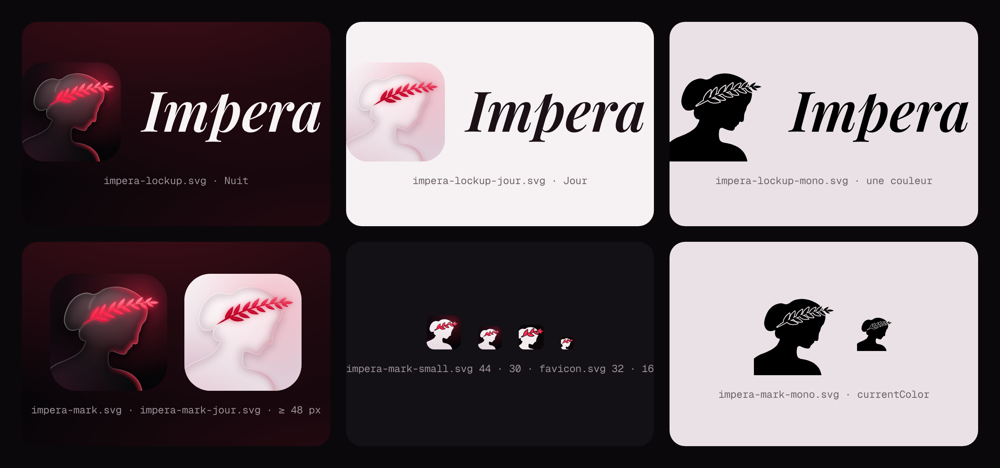

# Marque Impera

Le logo est le buste de marbre du logo de l'agence IMPERA, couronné de laurier, redessiné dans le design system : une statue de profil en verre fumé (Liquid Glass) sur la nuit chaude, et un laurier néon qui est la seule lumière. Le contour du buste a été redessiné à la main, en Bézier, d'après l'image « marbre sombre » choisie par Charles le 3 novembre 2026. Il a ensuite validé la version 7 et le wordmark A (Playfair italique, encre) le même jour.

## Fichiers

| Fichier | Quoi | Quand |
| --- | --- | --- |
| `brand/impera-mark.svg` | Le symbole en Liquid Glass Nuit | Partout où il est affiché à 48 px ou plus : icônes d'app, bannière, lockups |
| `brand/impera-mark-jour.svg` | Le même en verre clair | Sur fond Jour |
| `brand/impera-mark-mono.svg` | Silhouette et laurier en une couleur (`currentColor`) | Impression, incrustation, badge de notification |
| `brand/impera-mark-small.svg` | Silhouette pleine et laurier néon, sans verre, sur la tuile Nuit | De 24 à 47 px : la barre latérale, l'en-tête des pages publiques, le popup de l'extension (copiée en `apps/web/public/impera-mark.svg` et `apps/extension/public/icon/mark.svg`) |
| `brand/favicon.svg` | Version simplifiée (tête plus grande, trois feuilles), sans verre | Favicon et 16 px |
| `brand/impera-lockup.svg` | Symbole + « Impera » | Sur fond Nuit |
| `brand/impera-lockup-jour.svg` | Même lockup, nom en encre Jour | Sur fond Jour |
| `brand/impera-lockup-mono.svg` | Lockup en une couleur | Signatures, documents, partenaires |
| `brand/banner.svg` | Bannière du README | En-tête du README |

Le nom est un tracé vectorisé de Playfair Display italique 600 (Google Fonts, licence OFL), en encre (`#f8f3f4` sur Nuit, `#1b1016` sur Jour), jamais éclairé : le laurier reste la seule lumière. Dans l'interface, le nom est du texte dans la même police (`.nv-wordmark`).

## Règles

- **Une seule lumière** : le laurier néon. On n'ajoute aucun autre éclat, et on ne colore pas le nom.
- **Tailles** : le verre dès 48 px, la silhouette pleine (`impera-mark-small.svg`, icônes 32 et 48 de l'extension) de 24 à 47 px, `favicon.svg` en dessous.
- **Ne pas** recolorer, incliner ou étirer le symbole, retourner le profil, détacher le laurier du buste, ni ajouter un contour ou une ombre dure.
- **Couleurs** : laurier en dégradé `neon-ink` `#ff8fa0` → `neon` `#ff2a4d` → `#e3123f`, avec une lueur `neon` floutée et des nervures `#ffe3e8` ; sur Jour `#ff4d6a` → `#cc0029` → `#a8001f`. Fond Nuit `#140a10` → `#050406`, lueur rouge derrière le laurier ; fond Jour `#f8f1f4` → `#dfccd6`.
- **Icônes d'app** : `icon-192` et `icon-512` ont les coins arrondis, avec une transparence autour. `apple-touch-icon` (180) et `icon-maskable-512` sont pleins, à bords perdus, car iOS et Android appliquent leur propre masque ; le maskable garde tout le dessin dans la zone sûre de 80 %.

## Comment ils ont été faits

Le contour du buste a été posé point par point sur l'image de référence, puis lissé par une spline Catmull-Rom centripète. Les épaules sortent du cadre. Le laurier est une branche en Bézier quadratique : feuilles en amande légèrement variées, tige effilée qui naît dans le chignon. Le verre est un empilement de calques SVG : le fond grossi vu au travers, un voile blanc, une épaisseur sombre sur l'arête intérieure, le reflet rouge du laurier côté visage et un reflet blanc sur l'arête. Les PNG sont rendus par Chromium. Les sources de génération ne sont pas dans le dépôt : pour une retouche, on repart de ces SVG.
